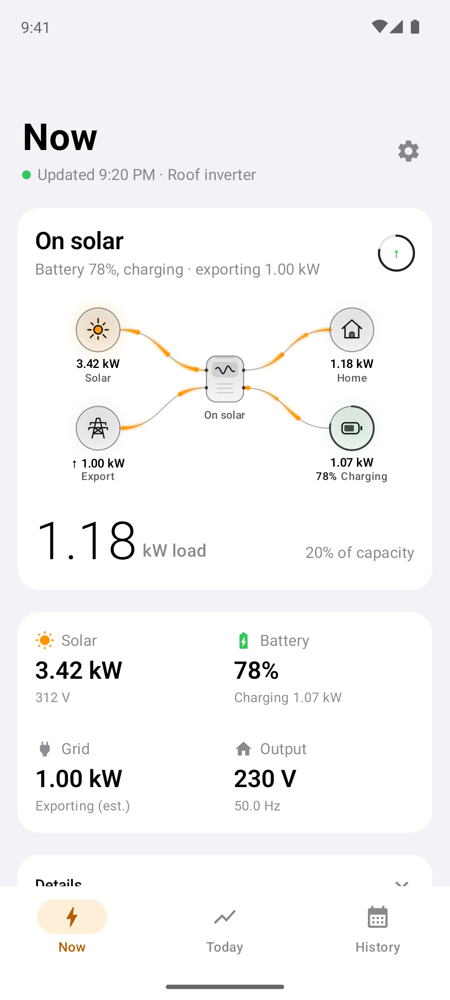
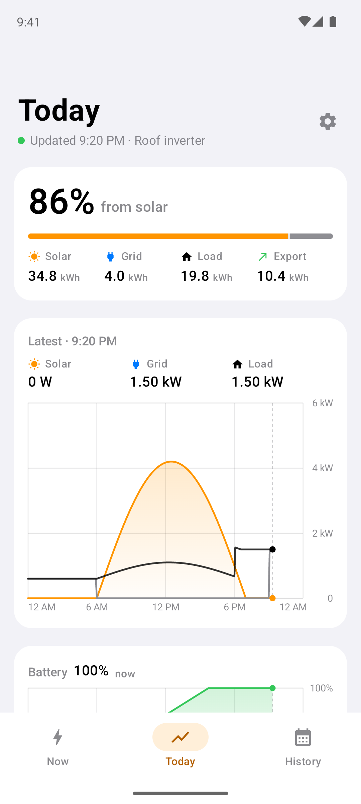
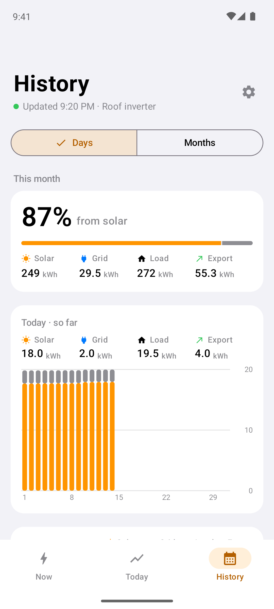

# Inverterly

> **Fork notice:** Inverterly is a personal fork of [InverterBar](https://github.com/ahkamboh/inverterbar) by Ali Hamza Kamboh, tailored for my own use. It adds in-app sign-in, an inverter switcher for accounts with more than one, daily and monthly solar, grid and load history, grid export estimates, and an iOS app and an Android app next to the original Mac app. The Mac app's release builds are signed with my Developer ID and notarized by me, [umarz317](https://github.com/umarz317). The iOS app is not on the App Store: you build it onto your own device. The Android app is not on the Play Store: there is a signed APK on the Releases page. This fork is not affiliated with or supported by the original author; please report issues with it here, not upstream.

Apps that show a Voltronic-type solar inverter live: what the panels are making, what the house is drawing, where the battery stands, and whether the grid is up. This repository holds all three, built from the same cloud client in Swift and Kotlin:

| | Platform | What it is | Install | Details |
|---|---|---|---|---|
| [macOS](#macos) | macOS 14+ | A menu bar panel | Build with a script, or the DMG on [Releases](https://github.com/umarz317/inverterly/releases) | [docs/macos.md](docs/macos.md) |
| [iOS](#ios) | iOS 17+ | A three-tab phone app | Build onto your device with Xcode | [iOS/README.md](iOS/README.md) |
| [Android](#android) | Android 8+ | A three-tab phone app | Signed APK on [Releases](https://github.com/umarz317/inverterly/releases), or build with Gradle | [android/README.md](android/README.md) |

These inverters are sold as Axpert, MPP Solar and under many other names. They all report to the vendor cloud read by the WatchPower, SolarPower and DessMonitor phone apps, and Inverterly reads that cloud with the account you already have.

It only reads. No code path in any app can change an inverter setting. This is an unofficial project, not affiliated with Voltronic, DessMonitor, ShineMonitor or any inverter brand.

Every app needs an inverter with a Wi-Fi logger that already reports to DessMonitor, WatchPower or SolarPower, and the login you use in that phone app.

## macOS

<p align="center">
  
</p>

A menu bar item that shows the battery percent, load or solar, and drops a panel with the animated energy flow, today's chart, daily and monthly history, and a details list.

**Requirements:** macOS 14 or later and Xcode's command line tools.

**Build and run**, from the repository root:

```bash
./Scripts/build-app.sh install     # builds Inverterly.app, copies it to ~/Applications and opens it
swift run Inverterly               # or run it straight from source
```

Without `install` the script only builds into `dist/`. A signed and notarized DMG of each Mac release (the `v0.1.x` releases) is on the [Releases page](https://github.com/umarz317/inverterly/releases); `./Scripts/make-dmg.sh` builds one yourself.

Signing in, the account file, options and history are in [docs/macos.md](docs/macos.md).

## iOS

<p align="center">
  
  
  
</p>

**Requirements:** iOS 17 or later, Xcode 16 or later, and an Apple development team for signing. A free personal team works; its builds stop opening after seven days and have to be installed again.

**Build and run:** open `iOS/Inverterly.xcodeproj`, choose the **Inverterly iOS** scheme, set your own team under Signing & Capabilities (the project ships with it blank) and run it on a simulator or your device. With a free personal team, also change the bundle identifier to your own.

```bash
open iOS/Inverterly.xcodeproj
```

The iOS app builds the same Swift package as the Mac app (`InverterCore` and `InverterUI`), so `swift build` and `swift test` at the repository root cover its shared code too. Installing on a real device, from the command line, and the debug demo mode are in [iOS/README.md](iOS/README.md).

## Android

<p align="center">
  
  
  
</p>

**Requirements:** Android 8.0 or later. To build it, JDK 17 and the Android SDK (platform 36); Android Studio has both.

**Install the APK:** each Android release (`android-v<version>`) on the [Releases page](https://github.com/umarz317/inverterly/releases) has a signed `Inverterly-<version>.apk`. Open it on the phone and allow installs from that source when Android asks. Play Protect may say it comes from an unknown developer, because it is not on the Play Store; "Install anyway" continues. A newer version installs over an older one and keeps the login.

**Build and run:** open the `android` folder in Android Studio and run the **app** configuration, or with a phone connected:

```bash
cd android
./gradlew :app:installDebug
```

The Android app is a Kotlin port of the Swift code, with its own tests (`./gradlew :app:testDebugUnitTest`). Release signing, the demo mode and the raw readings screen are in [android/README.md](android/README.md).

## What the apps show

- **Now**: whether the house runs on solar, battery or grid, the animated energy flow, the load against the inverter's rating, and a tile each for solar, battery, grid and output. Details (voltages, currents, frequency, logger status) are underneath.
- **Today**: how much of today's energy came from the sun, with solar, grid, load and export totals; the day's power curve, which you can drag across to read any moment; and the battery's charge through the day.
- **History**: Days for this month or Months going back, with the period's energy mix, a bar per day or month (drag to pick one), and the list.
- **Settings**: pick the inverter when the account has more than one, choose the illustration, and sign out.

The phone apps show these as three tabs; the Mac panel puts them in one panel with sections that open in place. The dot under each phone title is green while readings are fresh, orange once the logger has gone quiet, and grey before the first reading. The phone apps read while they are in front and stop when they are not; there is no background refresh or widget.

## Sign in

Use the username and password from your inverter's monitoring phone app. Each app tries the three cloud identities in turn and keeps the one that works.

- **Mac:** the password goes into the macOS Keychain, or into a private `.env` file if you turn that off. See [docs/macos.md](docs/macos.md).
- **iOS:** the password goes into the iOS Keychain. The username and app identity are saved in the app's own container, with the login session next to it.
- **Android:** the password is encrypted with a key held in the Android Keystore; the rest sits in the app's private storage, which is excluded from backup.

On the phones, with **Remember me** off, the account, session and saved history are removed the next time the app is launched, so it asks again. The password never appears in an error message or a log.

## How fresh the numbers are

The logger reports to the cloud about every five minutes, so that is the real resolution. The header shows when it last reported, and a banner appears after fifteen quiet minutes. The vendor's server can take ten seconds or more to answer, so the first reading after launch may be slow; the phone apps show a loading screen until it arrives.

Each day in History is added up from the logger's 5-minute readings, which matches the cloud's own daily solar figure to within about 1%. A finished day is read once and kept on the device; only today is read again.

Grid power is not in the vendor's data for this kind of inverter. The apps estimate it as load plus battery charging, minus solar and battery discharge.

## Grid export

An inverter that reports itself as a "Grid Tie" can send surplus power to the grid, but the cloud has no export reading for it: its grid power is always 0. So the apps estimate it as the power the panels make beyond the load and the battery's charging, less about 5% for conversion losses, and only with grid voltage present. A small surplus (60 W or less) is treated as measurement error. Summed over the logger's 5-minute readings it gives kWh exported per day and month.

It shows as an exporting Grid tile and a reversed grid flow on Now, an Export total on Today and History, and Export on each History row. Models that report "Off Grid Tie", or no type at all, never show export. It is an estimate: check it against your meter before relying on it for billing. Days saved before this was added are read from the cloud once more to fill it in.

## Documentation

- [docs/macos.md](docs/macos.md): the Mac app: install, the account file, options and history.
- [iOS/README.md](iOS/README.md): installing on your iPhone, demo mode, and how the app is built.
- [android/README.md](android/README.md): the Android app, release signing and the Kotlin port.
- [docs/API.md](docs/API.md): the cloud API: hosts, login and request signing, each route the apps use, and the settings routes they deliberately do not send.
- [docs/LIBRARY.md](docs/LIBRARY.md): using `InverterCore` from your own Swift code.
- [docs/examples/read_inverter.py](docs/examples/read_inverter.py): a 60-line read-only Python client.

## Code layout

```
Sources/InverterCore      cloud client, request signing, parsing, the EnergySnapshot model (Swift, no UI)
Sources/InverterUI        shared views and illustrations; the Mac panel and status item
Sources/InverterUI/Phone  the iOS screens, compiled only for iOS
Sources/Inverterly        the Mac app's entry point
Sources/InverterProbe     prints one live reading from the terminal
Scripts                   builds the Mac app and its DMG
iOS                       the Xcode project and thin app shell for iOS
android                   the Android app (Kotlin, Jetpack Compose)
Tests, Tools, docs        Swift tests, helper scripts, documentation and screenshots
```

## Tests

| App | Command | Covers |
|---|---|---|
| macOS and iOS (shared Swift) | `swift test` | cloud client, signing, parsing, history, grid export, the read-only guard, and the panel's state |
| Android | `cd android && ./gradlew :app:testDebugUnitTest` | the Kotlin port: signing vectors, parser, export, the read-only guard |

The fixtures are real answers from one inverter with serial numbers and ids replaced. `Tools/scan-secrets.py` checks that none of your account's values (username, password, serials, session token) has ended up in the repository; run it before pushing a fork.

## Licence

MIT. See `LICENSE`.
