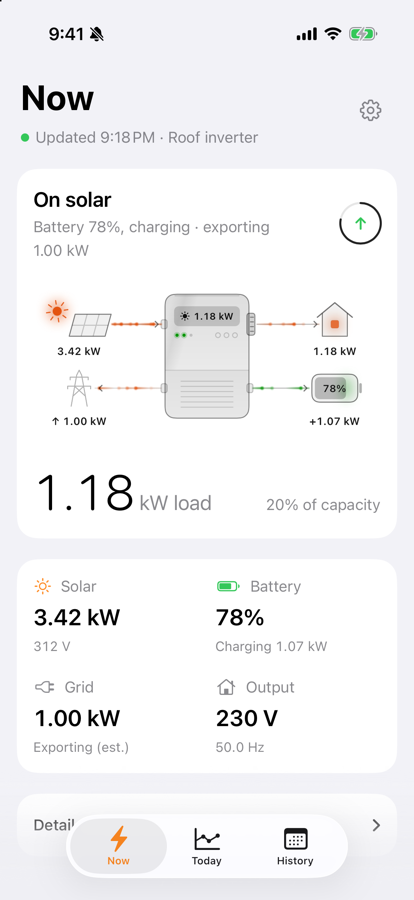
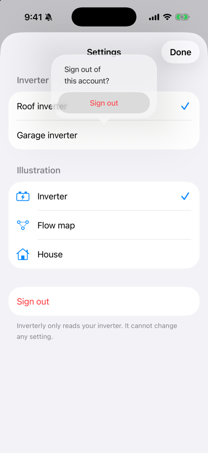
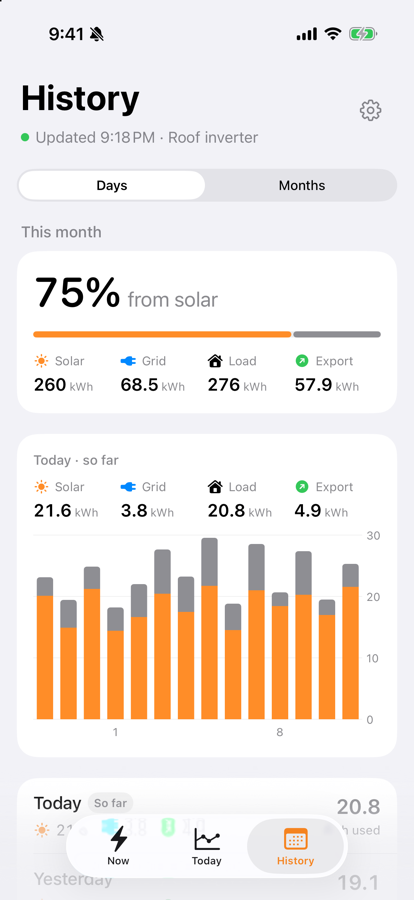

# Inverterly for iOS

> **Fork notice:** Inverterly is a personal fork of [InverterBar](https://github.com/ahkamboh/inverterbar) by Ali Hamza Kamboh, tailored for my own use. This branch adds an iOS app. It is not notarized, not on the App Store and has no release or download: you build it onto your own device with Xcode. This fork is not affiliated with or supported by the original author; please report issues with it here, not upstream.

An iOS app (iOS 17 or later) that shows a Voltronic-type solar inverter live: what the panels are making, what the house is drawing, where the battery stands, and whether the grid is up.

  

These inverters are sold as Axpert, MPP Solar and under many other names. They all report to the vendor cloud read by the WatchPower, SolarPower and DessMonitor phone apps, and Inverterly reads that cloud with the account you already have.

It only reads. No code path in the app can change an inverter setting. This is an unofficial project, not affiliated with Voltronic, DessMonitor, ShineMonitor or any inverter brand.

## What it shows

- **Now**: whether the house runs on solar, battery or grid, the animated energy flow, the load against the inverter's rating, and a tile each for solar, battery, grid and output. Details (voltages, currents, frequency, logger status) are underneath.
- **Today**: how much of today's energy came from the sun, with solar, grid and load totals; the day's power curve, which you can drag across to read any moment; the day's peaks; and the battery's charge through the day.
- **History**: Days for this month or Months going back, with the period's energy mix, a bar per day or month (drag to pick one), and the list.
- **Settings** (the gear): pick the inverter when the account has more than one, choose the illustration, and sign out.

  
  
  

The dot under each title is green while readings are fresh, orange once the logger has gone quiet, and grey before the first reading. Pull down on any tab to refresh. The app reads while it is in front and stops when it is not; it has no background refresh or widgets.

## Requirements

- iOS 17 or later.
- Xcode 16 or later to build it.
- An Apple development team for signing. A free personal team works; its builds stop opening after seven days and have to be installed again.
- An inverter with a Wi-Fi logger that already reports to DessMonitor, WatchPower or SolarPower, and the login you use in that phone app.

## Build and run

Open `iOS/Inverterly.xcodeproj`, choose the **Inverterly iOS** scheme, set your own signing team under Signing & Capabilities (the project ships with it blank) and run it on a simulator or your device. With a free personal team, also change the bundle identifier to your own.

To install on a real device, with every step and fix, see [iOS/README.md](iOS/README.md).

## Sign in

Use the username and password from your inverter's monitoring phone app. The app tries each of the three cloud identities in turn and keeps the one that works.

The password goes into the iOS Keychain. The username and app identity are saved in the app's own container, and the login session next to it. With **Remember me** off, the account, session and saved history are removed the next time the app is launched, so it asks again. The password never appears in an error message or a log.

## How fresh the numbers are

The logger reports to the cloud about every five minutes, so that is the real resolution. The header shows when it last reported, and a banner appears after fifteen quiet minutes. The vendor's server can take ten seconds or more to answer, so the first reading after launch may be slow.

Each day in History is added up from the logger's 5-minute readings, which matches the cloud's own daily solar figure to within about 1%. A finished day is read once and kept on the phone; only today is read again.

Grid power is not in the vendor's data for this kind of inverter. The app estimates it as load plus battery charging, minus solar and battery discharge.

## Grid export

An inverter that reports itself as a "Grid Tie" can send surplus power to the grid, but the cloud has no export reading for it: its grid power is always 0. So the app estimates it as the power the panels make beyond the load and the battery's charging, less about 5% for conversion losses, and only with grid voltage present. A small surplus (60 W or less) is treated as measurement error. Summed over the logger's 5-minute readings it gives kWh exported per day and month.

It shows as an exporting Grid tile and a reversed grid flow on Now, an Export total on Today and History, and Export on each History row. Models that report "Off Grid Tie", or no type at all, never show export. It is an estimate: check it against your meter before relying on it for billing. Days saved before this was added are read from the cloud once more to fill it in.

## Documentation

- [iOS/README.md](iOS/README.md): installing on your device, demo mode, and how the app is built.
- [docs/API.md](docs/API.md): the cloud API: hosts, login and request signing, each route the app uses, and the settings routes it deliberately does not send.
- [docs/LIBRARY.md](docs/LIBRARY.md): using `InverterCore` from your own Swift code.

## Code layout

- `iOS`: the Xcode project and thin app shell. See [iOS/README.md](iOS/README.md).
- `Sources/InverterUI/Phone`: the iOS screens, compiled only for iOS.
- `Sources/InverterUI`: the store, illustrations and shared views.
- `Sources/InverterCore`: cloud client, request signing, parsing and the `EnergySnapshot` model. No UI.

Run the tests with `swift test`. The fixtures are real answers from one inverter with serial numbers and ids replaced. `Tools/scan-secrets.py` checks that none of your account's values has ended up in the repository; run it before pushing a fork.

## Licence

MIT. See `LICENSE`.
