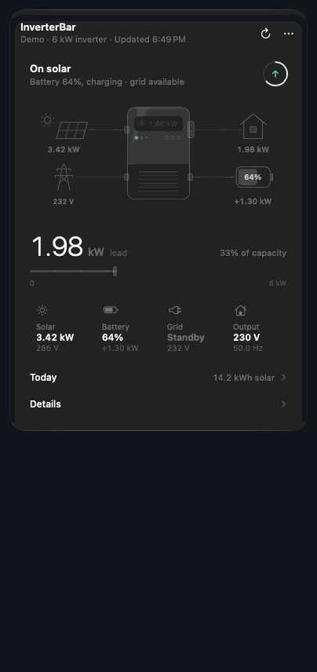

# InverterBar

A macOS menu bar app that shows a Voltronic-type solar inverter live: what the panels are making, what the house is drawing, where the battery stands, and whether the grid is up. These inverters are sold as Axpert, MPP Solar and under many other names, and all of them report to the same vendor cloud that the WatchPower, SolarPower and DessMonitor phone apps read. InverterBar reads that cloud with the account you already have.



The menu bar item is a small sun over a level bar. The bar is the battery's state of charge and the number beside it is the battery percent (or load, or solar, your choice). Click it and a panel opens with an animated picture of the energy moving, the load as a big number, four tiles for solar, battery, grid and output, a chart of today, and a details list.

It only reads. There is no code path in the app that can change an inverter setting.

This is an unofficial project. It is not affiliated with Voltronic, DessMonitor, ShineMonitor or any inverter brand.

## What you need

- macOS 14 or later, and Xcode's command line tools to build it.
- An inverter with a Wi-Fi logger that already reports to DessMonitor, WatchPower or SolarPower.
- The login you use in that phone app.

## Setup

Put the account in a small file that only you can read:

```bash
mkdir -p ~/.config/inverterbar
cp .env.example ~/.config/inverterbar/.env
chmod 600 ~/.config/inverterbar/.env
```

Then fill it in:

```
SHINEMONITOR_USER=your-login
SHINEMONITOR_PASSWORD=your-password
SHINEMONITOR_APP=dessmonitor
```

`SHINEMONITOR_APP` is `dessmonitor`, `watchpower` or `solarpower`, whichever phone app you sign in to. DessMonitor is https. The other two talk to their cloud over plain http, as their phone apps do, and have not been tested with this app. Two more keys, `SHINEMONITOR_PN` and `SHINEMONITOR_SN`, choose a device when the account has more than one.

The app looks for the file in these places, in order:

1. the path in the `INVERTERBAR_ENV` environment variable
2. the path saved in the app's defaults: `defaults write com.ahkamboh.inverterbar envPath "/path/to/.env"`
3. `~/.config/inverterbar/.env`
4. `~/Documents/inverter-control/.env`, if the file above does not exist

If the file is in Documents, Desktop or Downloads, macOS asks once whether InverterBar may read that folder. If you answer no, the panel says it cannot find the file; you can change the answer in System Settings under Privacy & Security, Files and Folders.

The login session is kept in `~/Library/Application Support/InverterBar/session.json`, readable only by you. The password is never written anywhere by the app, and it never appears in an error message or a log.

## Build and install

```bash
./Scripts/build-app.sh install
```

That builds a release binary, wraps it as `InverterBar.app`, copies it to `~/Applications` and opens it. Run it without `install` to only build into `dist/`. The app is signed ad hoc, which is enough to run on the Mac that built it.

To start it at login, open the panel, click the three dots, and turn on "Open at login".

## Options

The three-dot menu in the panel has:

- Illustration: which animated picture the panel shows. "Inverter" draws the unit with power streaming through it, "Flow map" is a diagram of the four flows, and "House" is a small scene with the roof array, the battery and the grid pole.
- Menu bar shows: battery percent, load, solar, or the icon alone.
- Animate menu bar icon: the icon moves for a few seconds each time a new reading arrives, then rests. Turn it off for a still icon.
- Open at login.

## How fresh the numbers are

The Wi-Fi logger reports to the cloud about every five minutes, so that is the real resolution. The app asks the cloud once a minute while the panel is open and every two and a half minutes otherwise. The header shows when the logger last reported, and a banner appears if it has been quiet for more than fifteen minutes. When that happens, or when nothing could be fetched for ten minutes, the menu bar item drops its number and dims, so an old percentage is never shown as if it were current.

The vendor's server sometimes takes ten seconds or more to answer. The first reading after launch can be slow for that reason; the panel says "Reading your inverter" until it arrives.

Grid power is not in the vendor's data for this kind of inverter. The app works it out as the load plus battery charging, minus solar and battery discharge, and labels it as estimated in the details list.

## What it costs to leave running

Measured on an M1 Pro over three minutes with the panel closed: 0.17% of one CPU core on average, 17 MB of memory, and one small request every two and a half minutes. With the panel open and the picture moving it uses about 3% of a core, and it stops drawing when the panel closes.

## Documentation

- [docs/API.md](docs/API.md): the cloud API. Hosts, how login and request signing work with worked examples, every route the app uses with a sample answer, what each report row means, the error codes, and the settings routes the app deliberately does not send.
- [docs/LIBRARY.md](docs/LIBRARY.md): using `InverterCore` from your own Swift code.
- [docs/examples/read_inverter.py](docs/examples/read_inverter.py): a 60-line read-only client in Python, written from the API page alone.

## Trying it without an inverter

```bash
swift run InverterBar --demo --open
```

`--demo` cycles through made-up situations every six seconds (sunny and charging, evening on battery, night on grid, an outage with a low battery, standby). `--open` opens the panel as soon as the app starts and keeps it open when you click elsewhere. `--tour` does the same and also opens and closes the Today and Details sections on a timer, which is handy for recording a clip. `--style device`, `--style flow` or `--style scene` picks the illustration for that run without changing the saved choice.

The illustrations and the whole panel can be rendered to PNG without opening anything:

```bash
swift run HeroLab panel ./out
swift run HeroLab icon ./out
```

To print one live reading in the terminal:

```bash
swift run InverterProbe
```

## The demo video

`docs/inverterbar-demo.mp4` (49 seconds, 1080 x 1350, voice-over and subtitles) is built by one script:

```bash
Tools/demo-video/make.sh
```

Nothing is recorded from the screen. `DemoVideo` draws every frame from the app's own panel and illustrations at the made-up demo readings, with a drawn desktop, menu bar and pointer around them, so the panel's header says "Demo". The spoken lines are in `Tools/demo-video/narrate.py`; each shot lasts as long as its line, so editing a line retimes the video. The voice is Kokoro running offline, which needs `python3.14` with `kokoro-onnx` and `numpy`, and the encode needs `ffmpeg`.

`Tools/demo-video/polish-recording.sh` is for a screen recording of your own: it cleans the voice track and speeds the recording up.

## Layout of the code

- `Sources/InverterCore`: the cloud client, request signing, parsing, and the `EnergySnapshot` model. No UI.
- `Sources/InverterUI`: the status item and its panel window (`StatusItemController`), the panel's SwiftUI views, the menu bar icon, and the heroes in `Hero/`. Each hero is one SwiftUI `Canvas` that is a pure function of the reading and the time, which is what lets `HeroLab` draw any instant of an animation.
- `Sources/InverterBar`: the app entry point.
- `Sources/HeroLab`: the PNG renderer.
- `Sources/InverterProbe`: prints one live reading in the terminal.
- `Sources/DemoVideo`: the frame-by-frame renderer for the demo video.

Tests are in `Tests/InverterCoreTests`. Run them with `swift test`. The fixtures there are real answers from one inverter with the serial numbers and ids replaced.

`Tools/scan-secrets.py` checks that none of your account's values (username, password, serials, session token) has ended up in the repository. Run it before you push a fork.

## Licence

MIT. See `LICENSE`.
