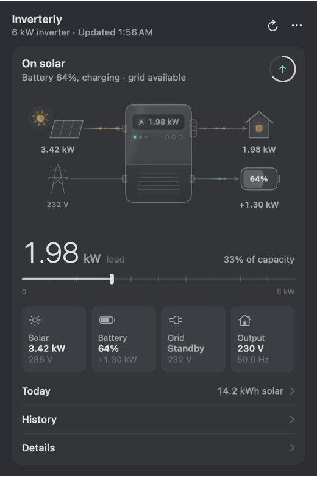
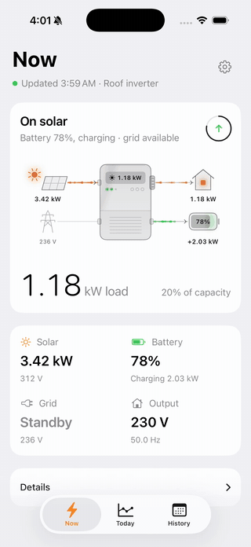

# Inverterly

> **Fork notice:** Inverterly is a personal fork of [InverterBar](https://github.com/ahkamboh/inverterbar) by Ali Hamza Kamboh, tailored for my own use. It adds an iPhone and iPad app, in-app sign-in, an inverter switcher for accounts with more than one, daily and monthly solar, grid and load history, and other changes. The Mac release builds are signed with my Developer ID and notarized by me, [umarz317](https://github.com/umarz317). Releases are for the Mac only; the iPhone and iPad app is not distributed, so you build it onto your own iPhone. This fork is not affiliated with or supported by the original author; please report issues with it here, not upstream.

A macOS menu bar app, and an iPhone and iPad app, that show a Voltronic-type solar inverter live: what the panels are making, what the house is drawing, where the battery stands, and whether the grid is up.

<p align="center">
  
</p>

These inverters are sold as Axpert, MPP Solar and under many other names. They all report to the vendor cloud read by the WatchPower, SolarPower and DessMonitor phone apps, and Inverterly reads that cloud with the account you already have.

The menu bar shows the battery percent, load, solar, or solar and grid together, each with its own icon; or just the app's glyph, a sun over a wave that turns to a moon when the panels make nothing. Click it for an animated picture of the energy flow, the load, tiles for solar, battery, grid and output, today's chart of solar, grid and load with totals so far, daily and monthly history, and a details list.

It only reads. No code path in the app can change an inverter setting. This is an unofficial project, not affiliated with Voltronic, DessMonitor, ShineMonitor or any inverter brand.

## Requirements

- macOS 14 or later, and Xcode's command line tools to build the Mac app.
- For the iPhone app: iOS or iPadOS 17 or later, and Xcode 16 or later to build it.
- An inverter with a Wi-Fi logger that already reports to DessMonitor, WatchPower or SolarPower.
- The login you use in that phone app.

## Install

```bash
./Scripts/build-app.sh install
```

This builds a release binary, wraps it as `Inverterly.app`, copies it to `~/Applications` and opens it. Without `install` it only builds into `dist/`. The app is signed ad hoc, which is enough to run on the Mac that built it.

### Release DMG

```bash
./Scripts/make-dmg.sh
```

This builds `dist/Inverterly-<version>.dmg` with the app signed by your Developer ID Application identity (the first one in your keychain, or `INVERTERLY_CODESIGN_IDENTITY`) using the hardened runtime, and signs the DMG too. To notarize and staple it, store notarytool credentials once with `xcrun notarytool store-credentials <name>` and run with `INVERTERLY_NOTARY_PROFILE=<name>`. Without notarization, other Macs show a Gatekeeper warning on first open.

### iPhone and iPad

The iPhone and iPad app (iOS 17 or later) is built from the same libraries as the Mac app and uses the same account. It has three tabs:

- **Now**: the animated energy flow, the load against the inverter's rating, tiles for solar, battery, grid and output, and a details list.
- **Today**: the share of today's energy from solar, the power curve (drag across it to read any moment), the day's peaks and the battery's charge.
- **History**: Days for this month or Months going back, with the energy mix, a bar per period and the list.

The gear opens settings: pick the inverter, choose the illustration, sign out. Pull down on any tab to refresh. The app reads only while it is in front; it has no background refresh or widgets.

<p align="center">
  
</p>

There is no release or download for it, and it is not on the App Store: you build it onto your own iPhone or iPad with Xcode and your own signing team. Open `iOS/Inverterly.xcodeproj` in Xcode, choose the **Inverterly iOS** scheme, set your signing team and run it on a simulator or your device. See [iOS/README.md](iOS/README.md) for installing on a real iPhone and for how sign-in is stored.

## Sign in

Click the menu bar item and enter your phone-app username and password. Inverterly works out which of the three apps the account belongs to and starts reading.

To switch accounts, open the three-dot menu and choose **Sign out**.

With **Save password in Keychain** on (the default), the password goes into your macOS Keychain and `~/.config/inverterly/.env` keeps only the username and app. With it off, the password is saved in that file, readable only by you. A password in the file wins; with none there, the app looks in the Keychain. The login session is kept in `~/Library/Application Support/Inverterly/session.json`, also private. The password never appears in an error message or a log. Sign out removes the account from both the file and the Keychain.

Coming from InverterBar: on first launch Inverterly moves `~/.config/inverterbar` and `~/Library/Application Support/InverterBar` to the new names, so the saved login and history carry over. `INVERTERBAR_ENV` is still read. Settings from the menu (illustration, menu bar choice, open at login) start fresh.

### Configure by hand

You can write the file yourself instead:

```bash
mkdir -p ~/.config/inverterly
cp .env.example ~/.config/inverterly/.env
chmod 600 ~/.config/inverterly/.env
```

```
SHINEMONITOR_USER=your-login
SHINEMONITOR_PASSWORD=your-password
SHINEMONITOR_APP=dessmonitor
```

- `SHINEMONITOR_PASSWORD` can be left out if the password is in the Keychain (service `com.loopbreak.inverterly`, account = your username).
- `SHINEMONITOR_APP` is `dessmonitor`, `watchpower` or `solarpower`. WatchPower and DessMonitor use the DessMonitor server over https and have been checked with live accounts. SolarPower uses plain http and has not been tested.
- `SHINEMONITOR_BASE_URL=http://android.shinemonitor.com/public/` selects the legacy server for an older WatchPower account.
- `SHINEMONITOR_PN` and `SHINEMONITOR_SN` choose the starting device when the account has more than one; the Inverter menu overrides them.

The app looks for the file in this order:

1. the path in the `INVERTERLY_ENV` environment variable
2. the path saved with `defaults write com.loopbreak.inverterly envPath "/path/to/.env"`
3. `~/.config/inverterly/.env`
4. `~/Documents/inverter-control/.env`, if the file above does not exist

If the file is in Documents, Desktop or Downloads, macOS asks once whether Inverterly may read that folder. If you say no, the panel reports that it cannot find the file; change the answer in System Settings under Privacy & Security, Files and Folders.

## History

Open **History** in the panel for how much solar you made, how much came from the grid and how much you used (the load), in kWh. **Days** lists each day of this month with a month total; **Months** adds up every month the cloud still has.

Each day is added up from the logger's 5-minute readings, which matches the cloud's own daily solar figure to within about 1%. Grid is estimated, as in the details list. A finished day is read once and kept in `~/Library/Application Support/Inverterly/history.json`; only today is read again. Sign out deletes it.

## Options

The three-dot menu has:

- **Inverter**: when the account has more than one, which inverter the panel and menu bar show. Each keeps its own history.
- **Illustration**: the animated picture in the panel. Inverter, Flow map or House.
- **Menu bar shows**: battery percent, load, solar, solar and grid together, or the icon alone.
- **Animate menu bar icon**: the icon moves briefly when a new reading arrives. Turn it off for a still icon.
- **Open at login**
- **Sign out**

## How fresh the numbers are

The logger reports to the cloud about every five minutes, so that is the real resolution. The app asks once a minute while the panel is open and every two and a half minutes otherwise.

The header shows when the logger last reported, and a banner appears after fifteen quiet minutes. If the logger has been quiet that long, or nothing could be fetched for ten minutes, the menu bar item drops its number and dims, so an old percentage never looks current.

The vendor's server can take ten seconds or more to answer, so the first reading after launch may be slow.

Grid power is not in the vendor's data for this kind of inverter. The app estimates it as load plus battery charging, minus solar and battery discharge, and labels it as estimated in the details list.

Left running, it uses about 0.17% of one CPU core and 17 MB of memory with the panel closed (measured on an M1 Pro), and about 3% of a core while the panel is open and animating.

## Run from source

```bash
swift run Inverterly
```

Print one live reading in the terminal, with the inverters on the account and yesterday's and today's totals:

```bash
swift run InverterProbe
```

## Documentation

- [docs/API.md](docs/API.md): the cloud API: hosts, login and request signing with worked examples, each route the app uses, error codes, and the settings routes the app deliberately does not send.
- [docs/LIBRARY.md](docs/LIBRARY.md): using `InverterCore` from your own Swift code.
- [docs/examples/read_inverter.py](docs/examples/read_inverter.py): a 60-line read-only Python client.

## Code layout

- `Sources/InverterCore`: cloud client, request signing, parsing and the `EnergySnapshot` model. No UI.
- `Sources/InverterUI`: the status item and panel window, SwiftUI views, menu bar icon, and the illustrations in `Hero/`. Each illustration is one `Canvas` that is a pure function of the reading and the time.
- `Sources/InverterUI/Phone`: the iPhone and iPad screens, compiled only for iOS.
- `Sources/Inverterly`: the app entry point.
- `Sources/InverterProbe`: prints one live reading, the inverters on the account and two days of totals.
- `iOS`: the Xcode project for the iPhone app. See [iOS/README.md](iOS/README.md).

Run the tests with `swift test`: `Tests/InverterCoreTests` for the cloud client, parsing and history, `Tests/InverterUITests` for the panel's state (history loading, switching inverters). The fixtures are real answers from one inverter with serial numbers and ids replaced.

`Tools/scan-secrets.py` checks that none of your account's values (username, password, serials, session token) has ended up in the repository. Run it before pushing a fork.

## Licence

MIT. See `LICENSE`.
